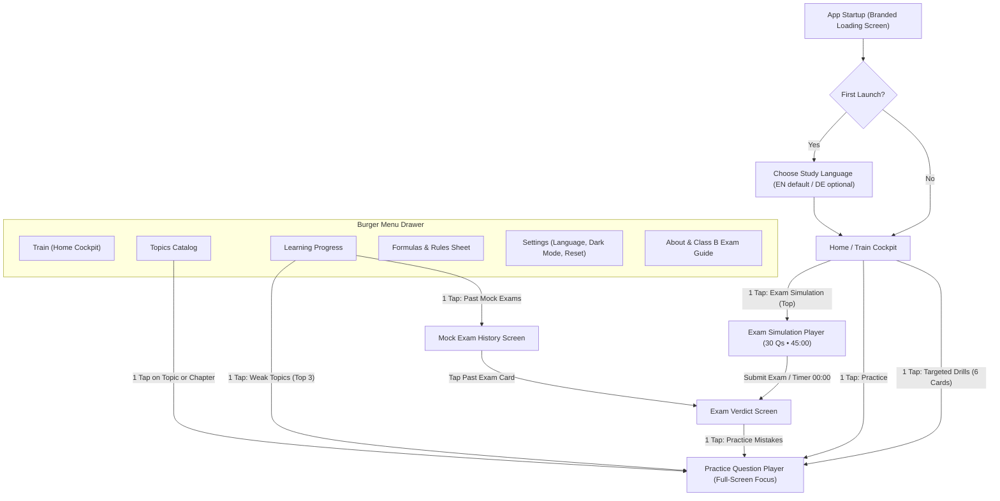

# Product & UX Specification: German Driving Theory Exam Trainer (Klasse B)

> **Role:** Principal UX Designer & Product Architect  
> **Target Platform:** Cross-platform Flutter Application — Mobile & Web (including Mobile Web browsers) + Linux/Desktop Split-View, Offline-Ready  
> **Dataset Baseline:** Official Bilingual German Class B Catalog (`assets/driving_theory_questions_b.json` in English & `assets/driving_theory_questions_de_b.json` in German — **1,592 questions** per language with matching `question_id`s across **14 Themes** and **92 Chapters**, including **464 static-image questions**, **225 cockpit-video questions** with end-frame freeze images, **57 numeric-input questions**, **8 three-sign visual-option questions**, and **276 `-M` visual-variant mother questions**).  
> **Authentication:** None. 100% local-first, zero-registration, instant-launch experience.

---

## 1. High-Level Overview & Product Vision

Preparing for the German theoretical driving exam (*Theoretische Führerscheinprüfung Klasse B* at TÜV or DEKRA) is a high-stakes, rule-dense milestone. Learners—both native German speakers and international residents taking the official exam in English—must master **1,592 official questions** where:
- Any multiple-choice question can have **1, 2, or all 3 answers correct**—missing a single ticked box or ticking one extra box yields **zero partial credit** and full *Fehlerpunkte* (2 to 5 error points).
- Answering **two 5-point questions wrong** causes an **instant exam failure** even though $5 + 5 = 10$ error points normally falls within the 10-point allowance.
- **Video hazard questions** follow strict, unforgiving exam-day playback rules (maximum 5 viewings *before* seeing the question text and options; zero replays once the question is revealed).

### Core UX North Star
Build **the fastest, calmest, most ergonomic German driving theory trainer ever made**—an app that feels uncluttered, purposeful, and intuitive in a mobile browser on a 4-minute U-Bahn ride just as well as on desktop or tablet during a full mock exam.

### Five Foundational Design Pillars
1. **Calm First-Launch & Zero-Ceremony Entry:** A branded startup loading screen transitions smoothly into an initial study language selection dialog (English default, German optional). No sign-up walls, cloud logins, or marketing banners.
2. **Clean Web & Mobile Navigation (Burger Drawer):** Replaces cluttered bottom navigation bars with an ergonomic drawer menu (Train, Topics, Progress, Formulas & Rules, Settings, and About), keeping web and mobile viewports spacious and distraction-free.
3. **Ergonomic Practice Drilling:** Every answer option is a single-click full-width card with visible checkboxes showing what the user selected. The primary action button anchors cleanly in the thumb zone with **Previous**, **Retry**, and **Next** navigation. Image zoom supports 1-tap view and double-tap 2x magnification. Traffic video controls sit beneath the clip with fullscreen landscape expansion.
4. **Authentic TÜV Mock Exam:** Mimics real test center conditions (30 questions, 45:00 countdown timer, 20 Grundstoff + 10 Zusatzstoff, max 10 error points / two-5-point fail rule, 5x pre-question video lock). Omits points values, topic names, and practice flags during the test to eliminate artificial cues.
5. **Clear Learning Telemetry:** A question is categorized as **Learned** once answered correctly 2 times in a row. Progress surfaces the Top 3 weak topics, clear Unseen / In Training / Learned status buckets, and a dedicated Mock Exam History screen.

---

## 2. Information Architecture & Navigation Model

### 2.1 Top-Level Sitemap

### 2.2 Navigation Chrome Rules
- **No Bottom Navigation Bar:** Because the application targets mobile web, desktop web, and mobile native, bottom navigation tabs take valuable vertical screen real estate. A responsive drawer menu contains:
  1. **Train** (`Üben`) — Cockpit with prominent Exam Simulation, Practice button, and 6 consistent drill cards.
  2. **Topics** (`Themen`) — Clean list of 14 topics with 1-tap theme drill, chapter accordion, and topic starring.
  3. **Progress** (`Fortschritt`) — Top 3 weak topics, Unseen / In Training / Learned question status buckets, and Past Mock Exams button.
  4. **Formulas & Rules** (`Faustformeln`) — Mandatory formulas (*Reaktionsweg*, *Bremsweg*, *Gefahrenbremsung*) and speed limits.
  5. **Settings** (`Einstellungen`) — App language switch (`EN` / `DE`), Dark / Light theme toggle, and progress reset.
  6. **About** (`Über die App`) — Class B exam structure, passing rules, and zero-registration privacy statement.
- **Immersive Player Focus:** Entering Practice or Exam mode hides global navigation entirely, dedicating 100% of the screen to the question, media, option cards, and bottom action bar.

---

## 3. German Exam Rules & Learning Mechanics

### 3.1 Catalog Structure (`1,592` Class B Questions in Both `EN` and `DE`)
| Section | Canonical Theme Prefix | Official Scope | Themes | Questions | Exam Weight |
| :--- | :--- | :--- | :---: | :---: | :---: |
| **Grundstoff** (Basic Material) | `1.1` – `1.8` | General traffic rules, danger teaching, priority, road signs, environment | 7 | **823** | **20 questions** per exam |
| **Zusatzstoff Klasse B** (Class B Add-on) | `2.1` – `2.8` | Car-specific rules, technology, lighting, highways, dimensions/loads | 7 | **769** | **10 questions** per exam |
| **Total** | `1.x` + `2.x` | Complete Class B Question Pool | **14** (92 chapters) | **1,592** | **30 questions** per exam |

### 3.2 Authentic Exam Simulation Rules (TÜV / DEKRA Class B)
- **Question Generator:** Draws **30 unique questions** (20 Grundstoff + 10 Zusatzstoff).
- **Time Limit:** **45:00 countdown timer** (tap timer pill to hide/show digits).
- **Scoring:** Zero partial credit. Any missing or extra option adds full question error points (`2`, `3`, `4`, or `5`).
- **Pass Criteria:** Total error points $\le 10$ **and** fewer than two 5-point questions answered wrong.
- **Authentic Test Presentation:** Real test screens do not display question points or topic names, nor allow learning flags. Our mock exam faithfully follows this standard.
- **Unanswered Protection:** When submitting with unanswered questions, the app presents a modal with a direct **`Jump to Question N`** button.

### 3.3 Learning Telemetry & Status Buckets
Each question is classified into transparent, user-understandable buckets:
1. **Unseen:** Questions not yet attempted (0 attempts).
2. **In Training:** Attempted at least once, but not yet mastered (consecutive correct < 2).
3. **Learned:** Answered correctly **2 consecutive times in a row**. Making a mistake moves the question back to In Training until 2 consecutive correct answers are achieved.

---

## 4. Screen-by-Screen Specifications

### Screen 1: Home Cockpit (`Train`)
- **Header:** Drawer burger menu button, app title, and quick theme toggle.
- **PROGRESS Overview:** Replaces confusing labels with clean progress tracking: percentage learned, count of Learned questions, count of active mistakes, and count of unseen questions.
- **Exam Simulation (Top Position):** Prominently situated at the top of the screen:
  - Title: *Exam Simulation*
  - Subtitle: *30 questions • 45 min • Max 10 error points*
- **Practice Button:** Simple, uncluttered primary action button:
  - Title: *Practice*
  - Subtitle: *Mix of unseen questions and previous mistakes*
- **Targeted Drills (6 Uniform Cards):** Consistent visual card layout across all drill categories:
  1. *Most Mistakes* (questions with previous errors)
  2. *Least Answered* (unseen and low-practice questions)
  3. *5-Point Traps* (2 mistakes = exam fail)
  4. *Video Questions* (dynamic traffic scenes)
  5. *Number Input* (formula calculations and distance values)
  6. *Saved* (bookmarked questions)

### Screen 2: Practice Question Player
- **AppBar:** Close button, live session score pill (`✓ Correct  ✗ Wrong  N left`), question points pill, and bookmark star. Redundant language toggle removed (configured in Settings).
- **Media Stage:**
  - *Images:* No overlay zoom icon clutter. Tapping the image opens a fullscreen lightbox; double-tapping zooms to 2x magnification.
  - *Videos:* "Replay video" button placed beneath the video clip. A fullscreen button expands the video to fullscreen (automatically rotated to landscape on portrait phone screens).
- **Answer Selection:**
  - Standard checkboxes remain visible so the user clearly sees what they ticked.
  - Correctness indicated via card border, soft tint, and single-word status badges: **`Correct`**, **`Wrong`**, and **`Missed!`**.
  - No distracting error points banner ("+4 error points" removed during practice).
  - Clean **`Explanation`** chip/card replaces wordy prompts.
- **Navigation Controls:**
  - **Previous:** Backtracks to earlier questions in the active session.
  - **Skip:** Skips current unsubmitted question.
  - **Check Answer:** Evaluates the selected options.
  - **Retry:** Resets the current question so the learner can re-attempt it immediately.
  - **Next Question:** Advances to the next question in the queue.

### Screen 3: Topics Catalog
- **1-Tap Drilling:** Tapping any topic card starts drilling all questions in that topic immediately.
- **Accordion Chapters:** Tapping the chapter toggle expands individual chapters for sub-topic drilling.
- **Starred Topics:** Tapping the star icon favorites a topic, automatically pinning it to the top of the list for quick access.
- **Clutter Removed:** Multi-select mode, category tabs, and search bar removed in favor of a lean, immediate catalog.

### Screen 4: Learning Progress Screen
- **Overall Coverage Gauge:** Circular visual indicator with Learned, Mistakes, and Unseen counts.
- **Top 3 Weak Topics:** Highlights only the top 3 topics with the highest error rates, each with a 1-tap drill button.
- **Question Learning Status:** Visual distribution of *Unseen*, *In Training*, and *Learned* questions with clear explanatory copy.
- **Mock Exam History:** A dedicated bottom button opening the separate `MockExamHistoryScreen`. (Reset and backup settings moved to Settings Screen).

### Screen 5: Settings Screen
- **Study Language:** Switch between English and German with immediate catalog reload while preserving progress.
- **Appearance:** Toggle between Light and Dark mode.
- **Reset Progress:** Confirmation dialog to reset all question tracking and exam records when restarting preparation.

### Screen 6: About Screen
- Information about the Class B theory test structure, passing criteria, and offline local-first privacy.

---

## 5. Critical User Journeys (CUJs) & Click-Count Budget

| # | Critical User Journey | Overhead Taps Before Q1 | Taps Per Question Answered |
| :- | :--- | :---: | :---: |
| **CUJ 1** | **Quick Daily Practice** (Home $\rightarrow$ Practice) | **1 tap** | $N$ option taps + **1** Submit + **1** Next |
| **CUJ 2** | **Launch Mock Exam** (Home $\rightarrow$ Exam Simulation) | **1 tap** | $N$ option taps + **1** Next |
| **CUJ 3** | **Drill Most Mistakes / 5-Point Traps** | **1 tap** | $N$ option taps + **1** Submit + **1** Next |
| **CUJ 4** | **Train a Starred Topic** | **1 tap** | $N$ option taps + **1** Submit + **1** Next |
| **CUJ 5** | **Change App Language or Theme** | **2 taps** | Drawer $\rightarrow$ Settings |
| **CUJ 6** | **Review Past Exam Attempts** | **2 taps** | Drawer $\rightarrow$ Progress $\rightarrow$ Past Exams |
