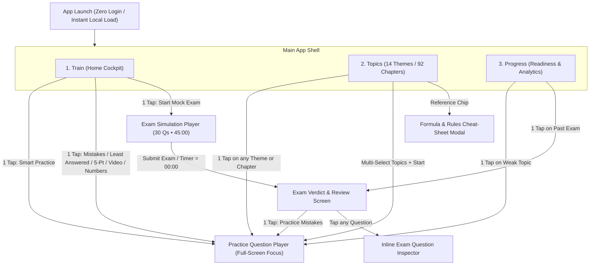

# Product & UX Specification: German Driving Theory Exam Trainer (Klasse B)

> **Role:** Principal UX Designer & Product Architect  
> **Target Platform:** Cross-platform Flutter Application — Mobile & Web (including Mobile Web browsers) + Linux/Desktop Split-View, Offline-Ready  
> **Dataset Baseline:** Official Bilingual German Class B Catalog (`assets/driving_theory_questions_b.json` in English & `assets/driving_theory_questions_de_b.json` in German — **1,592 questions** per language with matching `question_id`s across **14 Themes** and **92 Chapters**, including **464 static-image questions**, **225 cockpit-video questions** with end-frame freeze images, **57 numeric-input questions**, **8 three-sign visual-option questions**, and **276 `-M` visual-variant mother questions**).  
> **Authentication:** None. 100% local-first, zero-registration, instant-launch experience.

---

## 1. High-Level Overview & Product Vision

Preparing for the German theoretical driving exam (*Theoretische Führerscheinprüfung Klasse B* at TÜV or DEKRA) is a high-stakes, rule-dense milestone. Learners—both native German speakers and international residents taking the official exam in English—must master **1,592 official questions** where:
- Any multiple-choice question can have **1, 2, or all 3 answers correct**—missing a single ticked box or ticking one extra box yields **zero partial credit** and full *Fehlerpunkte* (2 to 5 error points).
- Answering **two 5-point questions wrong** causes an **instant exam failure** even though $5 + 5 = 10$ error points normally falls within the 10-point allowance.
- **Video hazard questions** follow strict, unforgiving exam-day playback rules (maximum 5 viewings *before* seeing the question text and options; zero replays once the question is revealed).

### Core UX North Star
Build **the fastest, calmest, most ergonomic German driving theory trainer ever made**—an app that feels native and effortless in a mobile browser on a 4-minute U-Bahn ride just as well as on a desktop or tablet during a 45-minute mock exam.

### Four Foundational Design Pillars
1. **Zero-Ceremony Entry:** No splash-screen carousels, no sign-up walls, no cloud accounts, no "choose a plan" modals. First app open lands directly on the actionable Training Cockpit.
2. **Muscle-Memory Mobile & Web Ergonomics:** Every answer option is a full-width single-tap card in the natural thumb zone, engineered for mobile touchscreens and mobile web viewports (`dvh`-safe sticky bottom bar, inline custom numeric keypad so mobile browser keyboards never resize/jump the viewport). The primary action button (*Check Answer* $\rightarrow$ *Next Question*) stays anchored at the **exact same screen coordinates**, with desktop keyboard parity (`Space`/`Enter` + `1`/`2`/`3`).
3. **Diagnostic Clarity & Seamless Bilingual Study (`DE | EN`):** A 1-tap **Language Selector (`DE` / `EN`)** switches both UI labels and the 1,592-question catalog instantly while **preserving 100% of learning progress** across shared `question_id`s. In Practice Mode, learners can also tap a 1-click **Translation Peek (`🌐 DE ↔ EN`)** to cross-check tricky traffic terminology without losing their place.
4. **Zero Exam-Day Surprises:** Practice Mode optimizes for learning speed and video scrubbing; Exam Mode faithfully enforces official TÜV/DEKRA Class B rules (30 questions, 45:00 timer, 20 *Grundstoff* + 10 *Zusatzstoff*, 10-point / two-5-point fail rule, 5x pre-question video lock).

---

## 2. UX Brainstorming & Concept Selection

Before converging on our architecture, we explored four distinct UX paradigms and brainstormed high-leverage features tailored to German driving learners.

### 2.1 Architectural Concepts Explored

#### Concept A: Classic Hierarchical Catalog ("The Digital Textbook")
- **How it works:** Opens to a tree of 14 Themes and 92 Chapters (`1.1 Danger Teaching` $\rightarrow$ `1.1.01 Basic Forms...`), mimicking traditional driving school workbooks.
- **Pros:** Predictable structure; aligns with evening *Theorieunterricht* lessons at the *Fahrschule*.
- **Cons:** High decision fatigue on launch (3–4 taps just to reach Question 1); poor cross-topic retention; users over-study `1.1` and neglect `2.7 Technology`.

#### Concept B: Linear Gamified Skill-Tree ("The Duolingo Path")
- **How it works:** Locks topics into sequential nodes with hearts, XP gems, streaks, and mascot animations.
- **Pros:** Approachable for reluctant learners; clear sense of "what to do next."
- **Cons:** Artificial locking frustrates learners who want to drill *Priority (`1.3`)* before tomorrow's driving lesson; celebratory transitions waste 2–3 seconds per question (adding 50+ minutes of dead time across 1,592 questions).

#### Concept C: Minimalist Endless Deck ("Anki / Tinder Swipe")
- **How it works:** Opens straight into a full-screen question stream powered purely by spaced repetition.
- **Pros:** Zero-click entry; maximal focus on questions.
- **Cons:** Opaque progress ("When am I actually ready for TÜV?"); weak support for targeted topic study or structured 30-question exam simulations; swipe gestures conflict with multi-select German questions.

#### Concept D (SELECTED): The Adaptive "Fahrschul-Cockpit" + Dual-Mode Ergonomic Player
- **How it works:** Combines a **1-Tap Smart Cockpit Home** with a **3-Tab Shallow Navigation Bar** (*Train*, *Topics*, *Progress*) and a **Fixed-Thumb-Zone Question Player**.
  - The Home Cockpit surfaces an honest **Exam Readiness Gauge**, a giant **1-Tap Smart Session CTA** (auto-blending unseen, low-exposure, and mistake-prone questions), **1-Tap Smart Filter Pills** (*Frequent Mistakes*, *Least Answered*, *5-Point Traps*, *Videos*, *Numbers*), and a **1-Tap Exam Simulation launcher**.
  - Learners who want structured study switch to **Topics** in 1 tap and launch any Theme or Chapter immediately.
- **Why Concept D Wins:** It delivers **1-tap entry** like Concept C, **full catalog control** like Concept A, and **adaptive guidance** like Concept B—with zero gamified bloat.

| Evaluation Criterion | A: Catalog Tree | B: Gamified Path | C: Endless Deck | **D: Adaptive Cockpit (Winner)** |
| :--- | :---: | :---: | :---: | :---: |
| Taps to answer 1st question | 3–4 taps | 2–3 taps | **0–1 taps** | **1 tap** |
| Mistake & Low-Exposure Drilling | Manual | Hidden | Automatic only | **1-Tap Smart Pills + Auto** |
| Topic-Specific Study | Excellent | Poor (Locked) | Weak | **Excellent (1-Tap Topics Tab)** |
| Honest TÜV Readiness Clarity | Low | Medium (XP != Pass) | Low | **High (Readiness % + Mock Pass Rate)** |
| Speed per 50-Question Sprint | Fast | Slow (Animations) | Fast | **Fastest (Fixed-Coordinate CTA)** |

---

### 2.2 Brainstormed High-Impact Features for the German Exam

Beyond the core requirements, we evaluated domain-specific pain points of Class B candidates in Germany and selected the highest-ROI features to include in the design:

1. **Instant Bilingual Language Switcher (`DE | EN`) + Practice Translation Peek (Included):**
   - Top-bar 1-tap `DE | EN` toggle switches both UI and question text between official German and English while sharing unified `question_id` mastery telemetry. Inside Practice Mode, a `🌐` button lets learners peek at the alternate language inline without changing their global setting.
2. **3-Stage Mastery & "Trouble Questions" (*Problemkinder*) Engine (Included):**
   - Simply answering a question right once can be a lucky guess. Each question moves through **Unseen** $\rightarrow$ **Learning (1x right)** $\rightarrow$ **Mastered (2x consecutive right)**. Any wrong answer immediately tags the question as a **Mistake** and resets consecutive streak to `0` (requiring 2 consecutive correct answers to clear).
3. **Smart Drill Presets: "Most Mistakes" & "Least Answered" (Included — Core + Enhanced):**
   - Dedicated 1-tap smart queues on the Home Cockpit for **Mistakes** (sorted by highest mistake-to-attempt ratio & recent failures) and **Least Answered** (prioritizing `0`-attempt unseen questions first, then `1`-attempt questions).
4. **"5-Point Instant-Fail Trap" Drill (Included):**
   - Because getting just *two* 5-point questions wrong fails the German exam, a dedicated 1-tap **5-Point Questions** filter lets learners bulletproof the highest-risk items (`Right-of-Way`, `Cockpit Hazards`, `Braking`).
5. **Dual-Behavior Video Player: "Exam Realism" vs. "Practice Scrubbing" (Included):**
   - *Exam Mode:* Enforces official TÜV rules—up to 5 plays, no pause/scrub, and switching to the question permanently replaces the video with the final freeze-frame (`Standbild` from `local_image_paths`).
   - *Practice Mode:* Defaults to instant playback with option to toggle Exam-Style hidden question, **and** after submitting an answer, unlocks a **scrubbable video timeline + replay** so the learner can rewind and spot the hidden cyclist in the mirror!
6. **`-M` Mother-Question Variation Callout (Included):**
   - 276 questions in our catalog end with `-M` (*Mutterfrage*). On exam day, TÜV randomizes car colors, weather, or vehicle types (van vs. sedan) in these scenes so rote image memorizers fail. In Practice explanations, `-M` questions display a subtle **"Exam Variation Notice"** badge reminding learners to learn the *traffic rule*, not the red car's color.
7. **German/English Comma-Normalized Custom Numpad (Included):**
   - 57 questions require typing numbers (including decimals stored with German commas like `1,5`, `1,6`, `2,5`, `2,8`, `3,5`). Instead of triggering the OS/mobile-browser virtual keyboard (which shifts viewport height and mixes `.` vs `,`), the Question Player renders a clean inline **3x4 Ergonomic Numpad** where `.` and `,` are treated identically.
8. **Quick Reference Drawer: Braking Formulas & Road Signs (Included in Topics Tab):**
   - Instant cheat-sheet cards for the 3 mandatory German formulas (*Reaktionsweg*: $(\text{Speed} \div 10) \times 3$; *Bremsweg*: $(\text{Speed} \div 10)^2$; *Gefahrenbremsung*: $\text{Bremsweg} \div 2$) and key German regulatory limits.
9. **Local JSON Backup Export/Import (Included in Progress Settings):**
   - Keeps the zero-account promise while allowing seamless backup/restore across mobile web, native mobile, and desktop.

---

## 3. Information Architecture & Navigation Model

### 3.1 Top-Level Sitemap



### 3.2 Navigation Chrome Rules
- **3 Persistent Top-Level Destinations** (Bottom Navigation Bar on mobile & mobile-web portrait `< 840dp`; Left Navigation Rail on tablet/desktop/Linux $\ge 840\text{dp}$):
  1. **Train** (`Üben`) — Default landing screen.
  2. **Topics** (`Themen`) — Full catalog of *Grundstoff* (`1.x`) and *Zusatzstoff Class B* (`2.x`).
  3. **Progress** (`Fortschritt`) — Detailed metrics, weak-spot diagnosis, exam history, and local data backup.
- **Persistent Language Selector (`DE | EN`) & Theme Toggle:** Accessible in 1 tap from the top bar of the Main Shell (and via a translation peek toggle inside Practice Mode).
- **Immersive Focus Rule:** Entering the **Practice Question Player** or **Exam Simulation Player** hides the bottom navigation bar completely so 100% of vertical real estate belongs to the traffic media, question, answer cards, and primary thumb CTA.
- **Instant Session Persistence:** Every tap in Practice or Exam mode saves locally. Closing the app or browser tab mid-exam resumes seamlessly from a **"Resume Active Exam"** banner on the Home Cockpit.

---

## 4. German Exam Rules & Smart Learning Mechanics

### 4.1 Catalog Structure (`1,592` Class B Questions in Both `EN` and `DE`)
| Section | Canonical Theme Prefix | Official Scope | Themes | Questions | Exam Weight |
| :--- | :--- | :--- | :---: | :---: | :---: |
| **Grundstoff** (Basic Material) | `1.1` – `1.8` | General traffic rules, danger teaching, priority, road signs, environment | 7 | **823** | **20 questions** per exam |
| **Zusatzstoff Klasse B** (Class B Add-on) | `2.1` – `2.8` | Car-specific rules, technology, lighting, highways, dimensions/loads | 7 | **769** | **10 questions** per exam |
| **Total** | `1.x` + `2.x` | Complete Class B Question Pool | **14** (92 chapters) | **1,592** | **30 questions** per exam |

### 4.2 Question Formats Supported
Every screen layout adapts cleanly to all **5 structural variants** present in the official Class B dataset:
1. **Standard Text Multiple-Choice (892 questions):** Question text + 2 or 3 text options (`A`, `B`, `C`), where **1, 2, or 3** options are correct.
2. **Static Image + Multiple-Choice (456 questions):** High-detail traffic illustration/photo (`local_image_paths[0]`) + question text + 2 or 3 text options.
3. **3-Sign Visual Multiple-Choice (8 questions, e.g., `1.4.40-013`):** Question text + 3 distinct road-sign images (`_a1.png`, `_a2.png`, `_a3.png`) mapped directly onto Answer Cards `A`, `B`, `C`.
4. **Cockpit Video + Multiple-Choice (225 questions):** 10–15s animated 3D traffic video (`local_video_paths[0]`) paired with an end-of-scene freeze-frame image (`local_image_paths[0]`).
5. **Numeric Free-Input / *Zahleneingabefragen* (57 questions, e.g., `1.2.02-111`):** `options: []`; user enters an integer or 1-decimal value (`0` to `130`, e.g., `60` km/h or `1,6` mm tread depth).

### 4.3 Authentic Exam Simulation Rules (TÜV / DEKRA Class B)
- **Question Generator:** Draws **30 unique questions** stratified realistically: **20 from Grundstoff (`1.x`)** and **10 from Zusatzstoff (`2.x`)**.
- **Time Limit:** **45:00 countdown timer**. Auto-submits when `00:00` is reached.
- **Scoring & Zero Partial Credit:**
  - A question awards **0 Fehlerpunkte** *only* if the user's selected set of options matches `correct_answers` **exactly** (or numeric value matches after `,`/`.` normalization).
  - Any discrepancy (1 missing correct option or 1 extra wrong option) adds the **entire question point value** (`2`, `3`, `4`, or `5` Fehlerpunkte).
- **Pass / Fail Conditions (First License / *Ersterwerb* — Default):**
  - **PASS (*Bestanden*):** Total Fehlerpunkte $\le 10$ **AND** fewer than two 5-point questions answered wrong.
  - **FAIL (*Nicht bestanden*):**
    - Reason A: Total Fehlerpunkte $\ge 11$, **OR**
    - Reason B (*Zwei-5-Punkte-Regel*): Total Fehlerpunkte $= 10$ caused by **two wrong 5-point questions**.

### 4.4 Per-Question Local Tracking & Smart Queue Ranking
For every `question_id` (language-independent!), local storage maintains lightweight telemetry:
- `attempts_count` (int), `correct_count` (int), `wrong_count` (int)
- `consecutive_correct` (int — resets to `0` on any mistake)
- `last_answered_at` (timestamp), `last_outcome` (`correct` | `wrong` | `unseen`)
- `is_bookmarked` (bool)

This powers the two requested smart filters with deterministic, transparent sorting:
1. **"Most Mistakes" Filter (`Fehlertraining`):**
   - Includes any question with `wrong_count >= 1`.
   - **Sort order:**
     1. Currently unrecovered mistakes (`last_outcome == wrong` or `consecutive_correct < 2`) first,
     2. Highest mistake rate ($\frac{\text{wrong\_count}}{\text{attempts\_count}}$) + total `wrong_count`,
     3. Higher `points` weight (`5` $\rightarrow$ `2`).
2. **"Least Answered" Filter (`Wenig geübt & Neu`):**
   - Prioritizes under-practiced questions across the entire catalog (or within a chosen topic).
   - **Sort order:**
     1. Ascending `attempts_count` (`0` unseen questions first, then `1` attempt, then `2` attempts...),
     2. Oldest `last_answered_at` timestamp as tie-breaker,
     3. Deterministic/shuffled tie-breaking so topics interleave naturally.

---

## 5. Ergonomics, Visual Design & Interaction System

### 5.1 Thumb-Zone, Mobile-Web & Fixed-Coordinate Action Architecture
On mobile and mobile-web portrait (`360–430dp` wide), the user holds the phone one-handed:
- **Top Bar (Glanceable Zone):** Exit button, live session score pill (`✓ 14   ✗ 2   ◷ 34 left`), points badge (`5 Pts`), translation peek (`🌐`), bookmark star.
- **Visual Media & Question Zone:** `16:9` image/video container + high-contrast question text (`18sp`–`20sp`). Tap image to zoom full-screen.
- **Single-Tap Answer Zone:** Full-width answer cards (`min-height: 56dp`). Tapping **anywhere** on the card toggles selection immediately.
- **Fixed-Coordinate Primary CTA Zone:** Full-width `52–56dp` primary button pinned above `SafeArea` bottom inset (avoiding mobile Safari/Chrome URL/home bars):
  - **Before submission:** Label is **`Check Answer`** (`Antwort prüfen`).
  - **After submission:** The **exact same button** transforms in place into **`Next Question →`** (`Nächste Frage →`).

### 5.2 Four-State Answer Highlighting System (Accessible & Colorblind-Safe)
Every submitted option card uses **Color + Border Style + Semantic Icon + Micro-Label**:

| Post-Submit Option State | Visual Border & Surface | Leading Badge / Icon | Trailing Micro-Label | Meaning to Learner |
| :--- | :--- | :--- | :--- | :--- |
| **1. Selected & Correct** *(True Positive)* | `2dp` Solid Emerald (`#15803D`), Soft Green Tint | Filled Green Checkbox + `✓` | **`Correct`** / **`Richtig`** | You rightly selected this answer. |
| **2. Selected & Wrong** *(False Positive)* | `2dp` Solid Crimson (`#B91C1C`), Soft Red Tint, strikethrough | Filled Red Box + `✗` | **`Wrong`** / **`Falsch`** | You ticked this, which cost you the question. |
| **3. Unselected & Correct** *(Missing Answer!)* | **`2dp` Dashed Amber (`#D97706`)**, Warm Highlight Tint | Outlined Check Ring + `!` | **`Missed!`** / **`Fehlt!`** | **Crucial:** This was ALSO right, and you forgot to select it! |
| **4. Unselected & Wrong** *(True Negative)* | `1dp` Muted Neutral, dimmed opacity | Empty Muted Checkbox | *(None)* | Correctly ignored; fades into background. |

### 5.3 Desktop, Linux & Web Keyboard Ergonomics
On wide viewports ($\ge 840\text{dp}$ split-screen layout: Media on Left, Question + Answers + Explanation on Right):
- `1`, `2`, `3` (or `A`, `B`, `C`): Toggle option A, B, C with a single keystroke.
- `Space` or `Enter`: Submit answer $\rightarrow$ press `Space` or `Enter` again to advance to Next Question.
- `B`: Bookmark/star question; `L`: Toggle translation peek.

---

## 6. Detailed Screen-by-Screen Specifications

### Screen 1: Home / Training Cockpit (`Train` Tab)
```text
┌──────────────────────────────────────────────────────────┐
│  🚗 Klasse B Trainer               [DE | EN]  🌙         │
├──────────────────────────────────────────────────────────┤
│  [Optional Resume Banner — only if exam paused]          │
│  ▶ Resume Mock Exam     (Q 18/30 • 24:10 left)    [Go]   │
├──────────────────────────────────────────────────────────┤
│  ┌────────────────────────────────────────────────────┐  │
│  │   ╭───────╮   EXAM READINESS: 68%                  │  │
│  │  │  68%   │   ✓ 940 Mastered  •  ✗ 74 Mistakes     │  │
│  │   ╰───────╯   ○ 578 Unseen of 1,592 total          │  │
│  │  ▓▓▓▓▓▓▓▓▓▓▓▓▓▓▒▒▒▒░░░░░░░░░  (59% + 5% + 36%)     │  │
│  └────────────────────────────────────────────────────┘  │
│  ┌────────────────────────────────────────────────────┐  │
│  │  ⚡ SMART PRACTICE                        [Start →]│  │
│  │  Adaptive mix of mistakes, unseen & review items   │  │
│  └────────────────────────────────────────────────────┘  │
│  TARGETED DRILLS (1 Tap to Start)                        │
│  [ ✗ Most Mistakes (74) ]    [ ○ Least Answered (578) ]  │
│  [ ⚠️ 5-Point Traps (198) ]  [ 🎬 Video Scenes (225) ]   │
│  [ 🔢 Number Input (57) ]    [ ★ Saved (19) ]            │
│  ┌────────────────────────────────────────────────────┐  │
│  │  ⏱️ EXAM SIMULATION (30 Qs • 45 min)      [Begin]  │  │
│  │  Official TÜV/DEKRA rules • Max 10 error points    │  │
│  └────────────────────────────────────────────────────┘  │
├──────────────────────────────────────────────────────────┤
│      [ ⚡ Train ]       [ 📚 Topics ]    [ 📊 Progress ] │
└──────────────────────────────────────────────────────────┘
```

### Screen 2: Practice Question Player
- **Top Status Header:** `✕` Close, live `✓ Correct • ✗ Wrong • N left` pill, `[Points]` pill, `🌐` Translation Peek toggle, `☆` Bookmark toggle.
- **Media Stage:** Collapses to `0dp` for text-only; zoomable `16:9` image for static-image items; inline `72x72dp` sign images inside option cards A/B/C for the 8 sign-option questions; cross-platform `16:9` video player with Practice Mode post-answer scrubbing and optional Exam-Style 5x lock preview.
- **Answer Cards & Custom Numpad:** Single-click full-width option cards (or inline `3x4` numpad normalizing `,` and `.`).
- **Auto-Expanded Explanation:** Automatically expands `comment` (plus `-M` variant callout when applicable) whenever the submitted answer is wrong or missing any correct option; expandable in 1 tap when correct.
- **Fixed-Coordinate Footer:** `[Skip ⏭]` + full-width `Check Answer` $\rightarrow$ `Next Question →`.

### Screen 3: Topic & Catalog Selector (`Topics` Tab)
- **Filter Chips & Live Search:** Filter by *All Class B (1,592)*, *Grundstoff 1.x (823)*, or *Zusatzstoff B 2.x (769)* + instant keyword/ID search + `[📐 Formulas]` reference modal.
- **1-Tap Theme & Chapter Launch:** Each of the 14 Themes shows `✓ Mastered • ✗ Mistakes • ○ Left` and starts immediately in 1 tap, or expands its chapters inline (`92` total chapters). Supports multi-topic selection mode.

### Screen 4: Exam Simulation Player (*Prüfungssimulation*)
- **Header:** `✕ Pause/Exit`, `⏱️ 45:00` (tap to hide/show digits), `Q X/30`, `[Grid ▦]` 30-question jump sheet, `[Submit]` button.
- **Strict 2-Phase Video Flow:** Up to **5 replays** before tapping `Show Question & Answers →`, after which the player locks to the end-frame `Standbild` (`local_image_paths[0]`).
- **Zero Mid-Exam Grading + Unanswered Guard:** Grades all 30 items upon submission, warning gently if any questions are unanswered or flagged (`⚑`).

### Screen 5: Exam Verdict & Mistake Breakdown
- **Hero Verdict Banner:** `PASSED (BESTANDEN)` or `FAILED (NICHT BESTANDEN)` with `X / 10` *Fehlerpunkte* meter, explicit *Two-5-Point-Rule* explanation when applicable, *Grundstoff* vs. *Zusatzstoff* breakdown, default `Wrong Only` review list, and 1-tap **`Practice These Mistakes Now`** launcher.

### Screen 6: Progress, Readiness & Insights (`Progress` Tab)
- **Catalog Coverage:** `✓ Mastered`, `✗ Active Mistakes`, `○ Unseen` across all 1,592 questions + overall accuracy.
- **Weakest Topics Ranking:** Ranked by mistake rate with 1-tap `[Train]` buttons.
- **Mock Exam History & Exposure Distribution:** Visualizes recent exam scores against the 10-point pass threshold, exposure buckets (`0x`, `1x`, `2+x`), and JSON Backup Export/Import + Reset Progress.

---

## 7. Critical User Journeys (CUJs) & Click-Count Budget

| # | Critical User Journey | Overhead Taps Before Q1 | Taps Per Question Answered |
| :- | :--- | :---: | :---: |
| **CUJ 1** | **Quick Daily Study** (App launch $\rightarrow$ Question 1) | **1 tap** | $N$ option taps + **1** Submit + **1** Next |
| **CUJ 2** | **Drill Frequent Mistakes** (`Most Mistakes`) | **1 tap** | $N$ option taps + **1** Submit + **1** Next |
| **CUJ 3** | **Practice Least-Answered / Unseen Questions** | **1 tap** | $N$ option taps + **1** Submit + **1** Next |
| **CUJ 4** | **Train a Specific Topic** (`Topics` $\rightarrow$ Theme) | **2 taps** | $N$ option taps + **1** Submit + **1** Next |
| **CUJ 5** | **Full 30-Question Mock Exam & Verdict** | **1 tap** | $N$ option taps + **1** Next |
| **CUJ 6** | **Switch App & Question Language (`DE` $\leftrightarrow$ `EN`)** | **1 tap** | Preserves 100% of progress |

---

## 8. Edge Cases, Accessibility & Dataset Implementation Notes

1. **Bilingual Unified IDs (`1,592` EN + `1,592` DE):** Both JSON catalogs share identical `question_id` keys. Canonical theme (`1.1`..`2.8`), chapter (`1.1.01`..), and integer point (`2`..`5`) parsers handle `"Theme 1.1."`/`"Thema 1.1."` and `"4 Points"`/`"4 Punkte"` seamlessly.
2. **Numeric Comma Normalization (`57` questions):** Both `"1,6"` and `"1.6"` evaluate identically via normalized decimal parsing.
3. **Video + Freeze-Frame Pairing (`225` questions):** `local_video_paths[0]` provides the MP4 clip while `local_image_paths[0]` serves as the poster and Exam Phase 2 `Standbild`.
4. **3-Sign Visual Option Questions (`8` questions):** Distinct `_a1.png`, `_a2.png`, and `_a3.png` road-sign assets are stored locally in `assets/images/` and referenced in `local_image_paths[0..2]` across both language catalogs.
